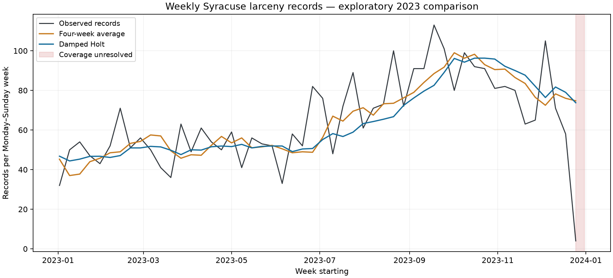

# Syracuse Crime Record Forecasting

Predict the **next week’s larceny record count** using completed weeks of Syracuse crime data. This project compares simple forecasting methods with reproducible chronological evaluations. It counts source records, not verified unique incidents or individual risk.

**Latest result: exponential smoothing did not beat the four-week average.** Damped Holt smoothing won the 2022 comparison between two smoothing methods, but its 2023 mean absolute error (MAE) was higher:

| 2023 evaluation | Four-week average | Damped Holt smoothing |
|---|---:|---:|
| All 52 weeks | **12.01** records/week | 12.40 records/week |
| Exclude flagged December 25–31 week | **10.86** records/week | 11.27 records/week |

This is an **exploratory follow-up**, because 2023 outcomes had already been examined. The average remains the benchmark; neither this experiment nor the earlier Poisson model established an improvement on it.



Read the [findings](reports/smoothing/findings.md), [complete predictions and fitted parameters](reports/smoothing/metrics.json), [source audit](reports/smoothing/source-audit.json), and [artifact index](ARTIFACTS.md). The companion [analysis repository](https://github.com/ichen27/Syracuse-Crime-Data-Analysis) owns the audited loader.

## Quickstart

Requires Git and Python 3.12 (recommended). This work is currently on the PR branch shown below; the lock pins the shared loader to an immutable commit.

```bash
git clone --branch feat/temporal-model-evaluation https://github.com/ichen27/Temporal-Crime-Prediction-Classification-Model-w-Random-Forest-.git
cd Temporal-Crime-Prediction-Classification-Model-w-Random-Forest-
python3 -m venv .venv
source .venv/bin/activate
python -m pip install -r requirements-lock.txt
python -m pip install --no-deps -e .
python -m syracuse_model.download --output work/crime_data.db
syracuse-smooth experiment --database work/crime_data.db --output reports/smoothing
syracuse-smooth predict --model reports/smoothing/model.json
```

On Windows activate with `.venv\Scripts\activate`. The downloader checks the SHA-256 of the original database and refuses to overwrite different existing content. The experiment leaves that input unchanged and writes selection, metrics, fitted JSON state, findings, chart, and example forecast. It does not refresh the external source audit or overwrite the committed observation fixture. Skip downloading/training to predict from the included historical model with the final command.

## Input → output

Training uses completed Monday–Sunday larceny counts. Simple exponential smoothing learns a level and how strongly to weight recent observations; damped Holt also learns a trend whose effect diminishes over time. The experiment chooses between these two methods by 2022 rolling MAE. No seasonal search was added: the 2020–2023 window has only **208 complete weeks**, with fewer available at each training origin.

The inspectable [model.json](reports/smoothing/model.json) stores the selected method’s state, parameters, four baseline counts, versions, and data hash. It is fitted through **January 1, 2023**, and predicts January 2–8: about **46.77 records**, versus **45.25** for the average. It is a historical example, not a validated current model.

To advance the state after observing another week:

```bash
syracuse-smooth predict --model reports/smoothing/model.json \
  --observations reports/smoothing/example-observations.json
```

The input is a JSON list of `{"period_start": "2023-01-02", "count": 32}` objects. Weeks must be consecutive, starting at the saved model’s next week; counts must be nonnegative integers. The output estimates the following week and includes the same four-week baseline. See [example input](reports/smoothing/example-observations.json), [initial output](reports/smoothing/example-forecast.json), and [updated output](reports/smoothing/example-updated-forecast.json). Parameters stay fixed during this inference command; the benchmark separately refits them monthly. Estimates can be fractional and have no calibrated prediction interval.

## Evaluation and coverage

At each origin, predict one complete week before observing its count. Fit all earlier complete weeks at the first origin each month, and update states after each new observation. Both methods use the same available history. This is a sequence of one-week forecasts, not a year-ahead forecast. The source lacks historical ingestion/revision records, so the evaluation is retrospective rather than a reconstruction of what was actually available at the time.

The [protocol](reports/smoothing/protocol.json) fixed both candidates, selection rule, baseline, full 2023 window, and final-week sensitivity before calculating smoothing results. Only the selected smoothing method was evaluated on 2023. Both the full window and the sensitivity use identical weeks for the selected model and baseline; the latter removes a previously flagged week, not one chosen from the new model’s errors. Numerical nonconvergence retries the same objective with a second solver and records the solver; it never chooses fits by evaluation performance.

**The sparse tail remains unresolved.** The original database ends its 2023 Part 1 records on December 26, with only four larceny records in December 25–31. A separately retrieved city-source snapshot matches every December larceny daily count and has the same cutoff. Agreement shows this concern is also present upstream; it does not prove the final days represent zero records. The sensitivity result does not prove earlier weeks are complete either.

The city’s [2023 source metadata](https://www.arcgis.com/sharing/rest/content/items/94bc33f1a2c646b995d1ab356edf0730/info/metadata/metadata.xml?format=default&output=html) defines **DATEEND as the date reported**. This corrects the earlier description as an incident end date. That definition alone does not establish historical publication timing or justify assuming identical semantics in every older source. The loader preserves written calendar dates and audits schema/date exclusions. Calendar gaps are filled with zero under an explicit coverage assumption. Partial 2024 is excluded.

The dated audit contains aggregate counts only and can be refreshed separately, without replacing the training database:

```bash
python -m syracuse_model.audit_tail --database work/crime_data.db --output work/source-audit.json
```

**Next research priority:** establish source coverage and obtain genuinely untouched evaluation periods before claiming predictive improvement or choosing a deployment model.

## Earlier experiments

- [Poisson count experiment](docs/poisson-experiment.md): screened daily total, weekly total, and weekly larceny on 2022. Weekly larceny Poisson won selection but had 2023 MAE **12.91**, versus **12.01** for the average. Run `syracuse-forecast experiment` and `syracuse-forecast predict`; original reports and model remain under `reports/forecasting/`.
- [Date-to-category classification](docs/classification-experiment.md): preserved under `reports/`, with `syracuse-model train` and `syracuse-model predict`. Classification accuracy and forecast MAE measure different tasks. Original uploads remain in `legacy/`.

## Development and contributions

```bash
ruff check src tests
pytest -q
syracuse-smooth experiment --database work/crime_data.db --output work/smoothing-check
```

CI runs lint, tests, input acquisition, all three experiments, and saved-model predictions. Tests verify state recursions against statsmodels, current/future-data isolation, selection independence from 2023, monthly fit timing, sensitivity windows, and JSON input validation, alongside earlier regression checks. Use feature branches and PRs. For issues, include reproduction commands and versions with synthetic examples instead of individual records.

Method references: [Forecasting: Principles and Practice](https://otexts.com/fpp3/exponential-smoothing.html), [statsmodels implementation](https://www.statsmodels.org/stable/examples/notebooks/generated/exponential_smoothing.html).

## Attribution and licensing

Original project: Ivan Chen. Third-party packages retain their licenses. The original repositories specify no code/dataset license; this update does not grant new redistribution rights. Confirm source terms and obtain a license decision before redistribution or a licensed release.
