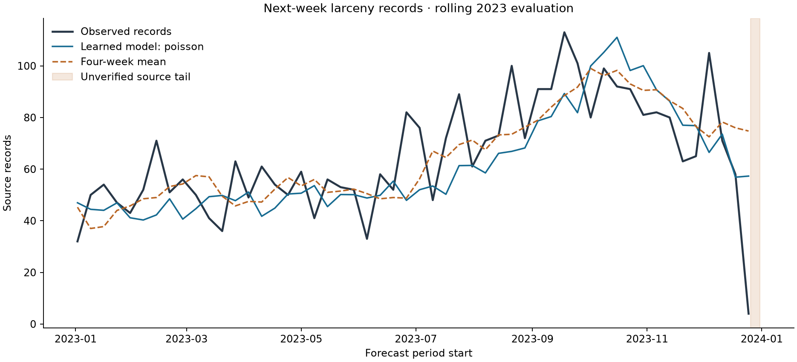

# Syracuse Crime Record Forecasting

An experiment in predicting **how many Syracuse crime records will occur in a future period**, using recent counts and calendar patterns. This is a change from the original task of predicting an individual record’s category from its date.

**Current target: next week’s larceny record count.** Inputs are the previous 13 completed weeks of larceny counts and the upcoming week’s calendar position. A regularized Poisson regression estimates the next Monday–Sunday total.

**Historical benchmark:** the learned model reduced validation error by **3.9% in 2022**, but did **not** improve on the baseline in 2023. Its average error was **12.91 records/week**, versus **12.01** for a four-week moving average. This is a useful, reproducible negative result: the task is more interpretable, but learned predictive value has not been established.



Read the [experiment findings](reports/forecasting/findings.md), [frozen target selection](reports/forecasting/selection.json), [full metrics and predictions](reports/forecasting/metrics.json), and [artifact index](ARTIFACTS.md). The companion [Syracuse analysis](https://github.com/ichen27/Syracuse-Crime-Data-Analysis) owns the audited data loader.

## Quickstart

Requires Git and Python 3.12 (recommended). The lock installs the shared loader at an immutable Git commit.

```bash
git clone https://github.com/ichen27/Temporal-Crime-Prediction-Classification-Model-w-Random-Forest-.git
cd Temporal-Crime-Prediction-Classification-Model-w-Random-Forest-
python3 -m venv .venv
source .venv/bin/activate
python -m pip install -r requirements-lock.txt
python -m pip install --no-deps -e .
python -m syracuse_model.download --output work/crime_data.db
syracuse-forecast experiment --database work/crime_data.db --output reports/forecasting
syracuse-forecast predict \
  --model reports/forecasting/forecast.joblib \
  --history reports/forecasting/example-history.json \
  --period-start 2023-01-02
```

On Windows activate with `.venv\Scripts\activate`. The downloader verifies an immutable source database by SHA-256 and refuses to overwrite different existing content. The experiment leaves the database unchanged and writes the selection, fitted artifact, metrics, findings, and chart. The example history/forecast files are committed fixtures, not regenerated by the experiment command.

Skip downloading/training to use the included model with the final command. **Load only trusted joblib files**, using the locked environment. A [sample input](reports/forecasting/example-history.json) and [sample output](reports/forecasting/example-forecast.json) are available without Python.

## Input → output

Provide a JSON list of at least 13 consecutive completed weeks, each with `period_start` (Monday, `YYYY-MM-DD`) and a nonnegative integer `count`. The list must be sorted and end immediately before the requested forecast week. Counts refer to records labeled `LARCENY` by the shared loader. The supplied example uses October–December 2022 to forecast January 2–8, 2023.

The output contains the model’s expected count, the four-week-average baseline, the forecast date range, and model limitations. The expected count is fractional; it is an estimate, not a promise of an exact count. There is no calibrated prediction interval. The saved model uses only complete periods ending before 2023 and is historical; providing modern history does not make it a validated current model.

## How the target was chosen

Three targets were declared before screening: next-day total records, next-week total records, and next-week larceny records. Each was evaluated with regularized Poisson regression and Poisson-loss gradient boosting, plus three simple baselines:

- Previous period’s count.
- Recent average: 28 days for daily targets, four weeks for weekly targets.
- Seasonal naïve: seven days ago for daily targets, 52 weeks ago for weekly targets.

The best learned model and baseline for each target were chosen by **2022 mean absolute error (MAE)**. The target with the greatest relative reduction versus its best baseline was selected. Comparing raw MAE across daily and weekly counts would be misleading. All candidate results are retained, including the weak gains.

Only that selected target/model specification was then evaluated on **2023**. Choices were saved to `selection.json` before test errors were computed. The model was not retuned after its test result. **2023 is now used evaluation data; future experiments need a fresh holdout or an explicitly exploratory label.**

## What a rolling forecast means

At each origin, we predict one day or one complete week ahead. Earlier observed periods supply lagged counts and shifted rolling means/standard deviations. Calendar covariates are known in advance. Models refit at the first forecast origin of each month using only periods already complete then. Thus earlier 2023 observations can inform later 2023 predictions; this is not a whole-year forecast issued in January.

The saved artifact is the initial pre-2023 fit, not all monthly evaluation fits. The public benchmark includes every evaluated forecast so the error calculations can be inspected. Weekly aggregation uses complete Monday–Sunday windows: the 2020–2023 window has **208 complete weeks**, much fewer training examples than its 51,000 records suggest. Periods straddling validation/test boundaries are excluded from the corresponding scores. Partial 2024 is excluded entirely.

## Data and limitations

The shared loader reads 55,851 rows from the 2020–2024 source tables and retains 55,779, explicitly auditing exclusions. It fixes the `CODE DEFINED`/`CODE_DEFINED` mismatch and mixed date formats. The 2019 table is excluded. The source database is unchanged.

These are **source-record counts**, not verified unique incidents, population-adjusted rates, or individual risk. `DATEEND` is an incident end date, not a reporting-availability timestamp. Records from later source tables can have earlier end dates. Consequently, this retrospective snapshot cannot establish what information was available at historical forecast times. Collection completeness is unverified; filling calendar gaps with zero records is an assumption, not evidence that no crime occurred. See the companion analysis for provenance limits.

**Specific coverage concern:** the last 2023 larceny record is December 26, matching the end of the source Part 1 table. The December 25–31 week contains only four records. That may reflect incomplete collection; it must not be interpreted as a real decline. The report flags the tail and retains the predefined test window instead of excluding an unfavorable week after seeing results. Calendar-complete weeks are not necessarily source-complete weeks.

The better 2022 score did not persist in 2023. The four-week average outperformed the trained model on the held-out comparison. Richer data with verified timing/coverage and additional genuinely untouched evaluation periods would be needed before claiming a useful forecasting model. No live deployment is included.

## Earlier classification experiment

The [date-to-category experiment](docs/classification-experiment.md) remains reproducible through `syracuse-model train` and `syracuse-model predict`; its artifacts remain in `reports/`. Its low macro F1 motivated trying another target. Classification accuracy and forecasting MAE measure different tasks and should not be presented as an old-versus-new score improvement. Original uploaded sources remain in `legacy/`.

## Development and contributions

```bash
ruff check src tests
pytest -q
syracuse-forecast experiment --database work/crime_data.db --output work/forecast-check
```

CI runs lint, tests, input acquisition, both experiments, and serialized prediction smoke tests. Tests check partial-week boundaries, zero days, label filtering, past-only features, selection independence from held-out records, rolling updates, history validation, and artifact round trips. Use feature branches and PRs. Include reproduction commands and package versions in issue reports; use synthetic data instead of individual record details.

References: [scikit-learn count regression](https://scikit-learn.org/stable/modules/generated/sklearn.linear_model.PoissonRegressor.html), [Poisson-loss boosting](https://scikit-learn.org/stable/modules/generated/sklearn.ensemble.HistGradientBoostingRegressor.html), and [forecasting benchmarks and chronological evaluation](https://otexts.com/fpp3/toolbox.html).

## Attribution and licensing

Original project: Ivan Chen. Third-party packages retain their licenses. The original repositories specify no code/dataset license; this update does not grant new redistribution rights. Confirm source terms and obtain a license decision before redistribution or a licensed release.
